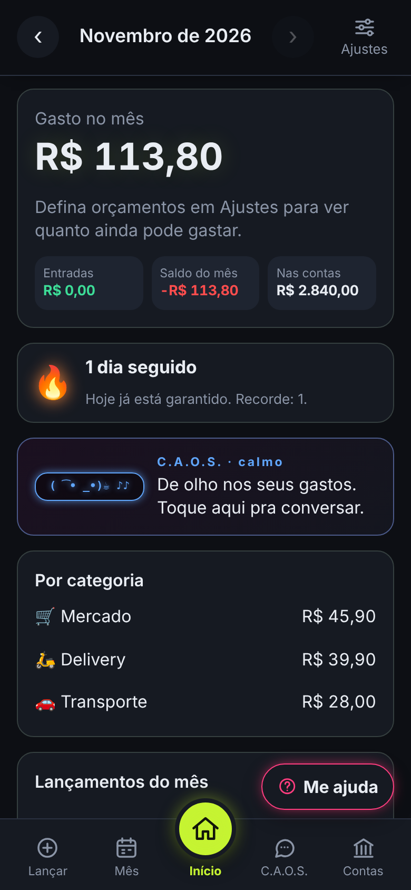
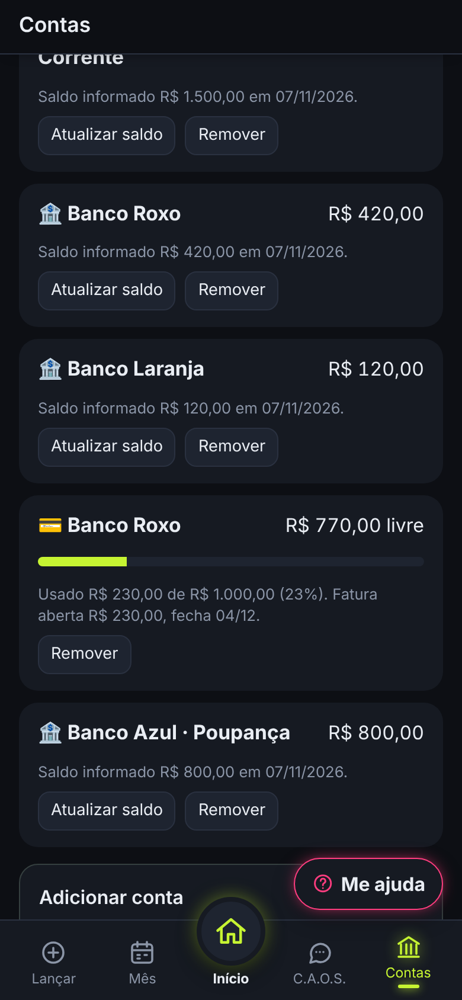
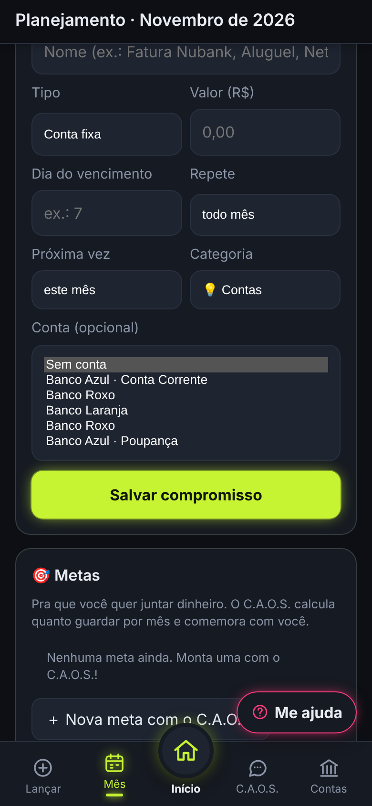
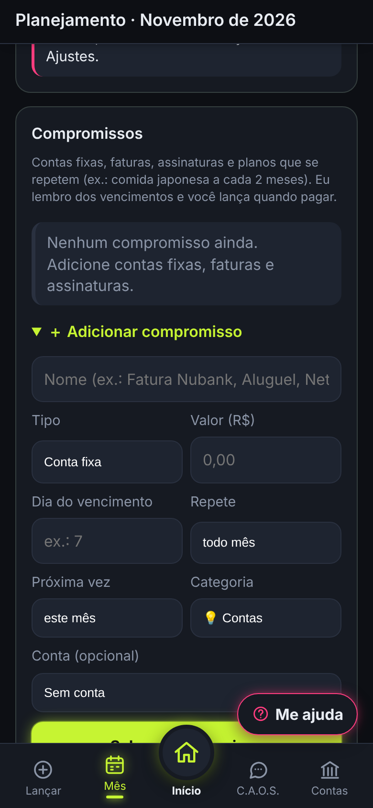
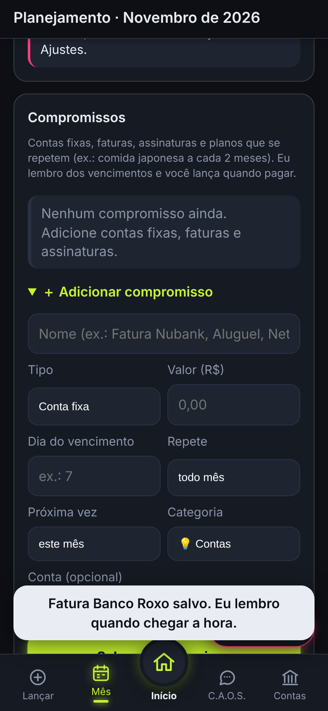
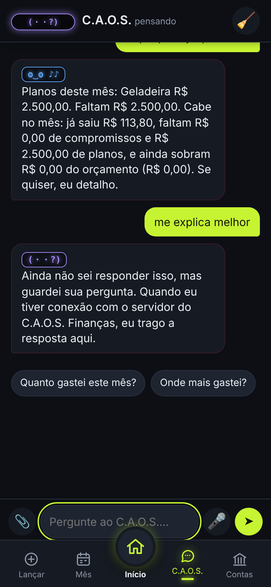

# C.A.O.S. Finanças · problemas pra estudar (vistoria do JF, 07/11/2026)

**Pra quem:** ChatGPT e Gemini (e quem mais o JF chamar). **De:** Wally (o Claude Code que mexe no app).
**O que espero:** que vocês **estudem a fundo** cada problema abaixo e sugiram **como resolver**: o comportamento
certo, os casos difíceis, as perguntas que o app deve fazer e, se quiserem, o desenho da solução (código só se for curto).
Não precisa reescrever arquivo nenhum: quem implementa é o Wally, na rodada de **quinta 12/11 e sexta 13/11**, conferindo
cada sugestão no código. Sugestão é informação pra pesar, não ordem.

---

## 1. O app em 1 minuto

- **C.A.O.S. Finanças** (antes "Carteira JF"): app de controle de gastos (PWA) em HTML, CSS e JavaScript puro, sem
  framework. Funciona **offline**: os dados ficam no celular (IndexedDB). Endereço: https://carteira-jf.pages.dev
- **O C.A.O.S.** é o personagem do app: um **parceiro financeiro**, não um assistente de banco. Conversa, analisa,
  comemora, puxa a orelha. Slogan: **"Um C.A.O.S. pra organizar o seu caos."** Ele entende a conversa por **regras**
  (sem IA) em `js/caos/conversa.js`; a IA online (servidor, ainda não publicado) só entra pra pergunta que ele não entende.
- **Abas:** Início · Lançar · Mês (planejamento, contas fixas, metas, planos) · C.A.O.S. (conversa) · Contas (bancos,
  cartões, investimentos) · Ajustes.
- **Amigos do JF já estão testando.** O básico precisa estar certo.

**Regras que não são bug (não sugerir mudar):** o C.A.O.S. nunca grava sozinho (ele propõe e a pessoa confirma);
dinheiro em centavos inteiros; sem framework/TypeScript/bundler; listas de falas com 5, 10, 15… itens; texto em
português do Brasil, simples, pra qualquer pessoa de 3 a 86 anos.

**Arquivos principais:** `js/engine.js` (contas e cálculos) · `js/caos/conversa.js` (entender a frase e responder) ·
`js/caos/falas.js` (as falas) · `js/app.js` (telas) · `index.html` · `css/styles.css`.

### Como o app está hoje (prints com **dados inventados**, refazendo o que o JF viu)

> Pra quem não consegue abrir o GitHub: o JF manda estes 6 prints junto com este arquivo.

| | |
| --- | --- |
|  **1. Início:** resumo do mês, ofensiva 🔥, o C.A.O.S. e as categorias. Barra embaixo: Lançar · Mês · **Início** · C.A.O.S. · Contas. |  **2. Contas (P5):** na ordem em que foram criadas. "Banco Azul · Poupança" ficou longe do "Banco Azul · Conta Corrente". |
|  **3. Escolher a conta (P6):** "Banco Roxo" aparece **duas vezes** (uma é a conta, a outra é o cartão). |  **4. "Me ajuda" (P10):** o botão flutuante fica em cima do "Salvar compromisso". |
|  **5. Aviso (P4):** retângulo branco, fora do visual escuro neon; "Fatura … salvo". |  **6. Conversa (P2/P3):** sem salário nem orçamento, ele diz "sobram R$ 0,00 do orçamento (R$ 0,00)"; "me explica melhor" → "Ainda não sei responder isso". |

---

## 2. Os problemas (o JF achou usando no celular)

### P1. "Gastei não sei quanto de internet" não vira nada, e ele não pergunta
- **Hoje:** a frase sem valor não vira lançamento e o C.A.O.S. não pergunta o que falta. (`conversa.js` → `entender()`
  só monta o lançamento quando acha o valor; `responder()`, caso `registrar_gasto`.)
- **Esperado:** ele **pergunta o que falta**, uma coisa de cada vez: "Quanto foi?" → "Foi no cartão, Pix ou dinheiro?" →
  "Internet parece conta de todo mês: quer que eu deixe como conta fixa?".
- **Pra estudar:** como fazer uma conversa em etapas (preencher os campos que faltam) sem virar formulário chato; o que
  fazer se no meio a pessoa muda de assunto; como saber que um gasto "parece recorrente" (internet, luz, streaming…).

- **Trecho do código** (`js/caos/conversa.js` → `entender()`): só vira lançamento **se achou um valor** (`r.valor`).
  Sem valor, a frase segue pras outras regras e acaba em "não entendi":
  ```js
  const r = { t, categoria: acharCategoria(t, categories), periodo: acharPeriodo(t), valor: acharValor(t), fonte: acharFonte(t) };
  // Registro ("gastei 30 no mercado", "paguei 120 de luz", "recebi 1500 de salario")
  if (r.valor && !/\bquanto\b/.test(t)) {
    if (/\b(recebi|ganhei|entrou|caiu|recebemos|me pagaram)\b/.test(t)) return { ...r, intent: 'registrar_entrada' };
    if (/\b(gastei|paguei|comprei|torrei|saiu|pedi|abasteci|gasto de|gastamos|passei|deixei|foram|foi)\b/.test(t)) return { ...r, intent: 'registrar_gasto' };
    // ... anotação curta ("uber 30")
  }
  ```
  E a proposta que ele devolve (o app mostra "Confirmar"):
  ```js
  acao: { tipo: 'registrar_gasto', amountCents: intencao.valor, categoryId: cat?.id ?? 'outros', date: today, note: ... }
  ```
  Ideia de caminho: se tem verbo de gasto mas **não tem valor**, devolver uma intenção "falta_valor" e guardar na memória
  da conversa o que já se sabe (categoria, descrição), pra próxima mensagem ("79,90") completar.

### P2. "Me explica melhor" cai em "ainda não sei responder"
- **Hoje:** depois de uma resposta com números ("Cabe no mês: já saiu R$ X, faltam R$ Y…"), "me explica melhor" não é
  entendido. O JF: *"se você é a IA e não sabe responder, você quebra minhas pernas"*.
- **Esperado:** "explica melhor", "não entendi", "como assim?" = **explicar a resposta anterior** em passos simples,
  com exemplo. (`conversa.js` já guarda a última intenção em `anterior`, usada pra "e no mês passado?".)
- **Pra estudar:** quais frases de "não entendi" o brasileiro usa; como transformar cada tipo de resposta (cabe no mês,
  previsão, orçamento, fatura) numa versão "explicada pra criança"; o que fazer quando não há resposta anterior.

- **Trecho do código** (`conversa.js` → `entender()`): a continuação de conversa só existe pra frases que começam com
  "e…" / "no/na/do…" ("e no mês passado?"); o resto cai em `nao_entendi`:
  ```js
  const continua = ... (/^e\b/.test(t) || /^(e )?(no|na|em|do|da|com|de|nos|nas)\b/.test(t) || (r0.intent === 'nao_entendi' && (r0.categoria || mencionaPeriodo(t))));
  if (continua && (r0.intent === 'nao_entendi' || r0.intent === 'gasto_total' || r0.intent === anterior.intent || r0.intent === 'comparar')) {
    // reaproveita a intenção anterior ...
  }
  // ...
  return { ...r, intent: 'nao_entendi' };   // fim da lista de regras
  ```
  A memória da conversa (`anterior`) guarda `{ intent, categoryId, periodo }` da última pergunta entendida.

### P3. "Cabe no mês?" sem salário lançado faz conta vazia
- **Hoje:** mostra "sobram R$ 0,00 do orçamento (R$ 0,00)" (`engine.js` → `cabeNoMes()` / `analisarPlanejamento()`).
- **Esperado:** sem base, **não fingir conta**: dizer o que falta e perguntar ("Quanto você recebe por mês? Me fala que
  eu já anoto como entrada") e então responder de verdade.
- **Pra estudar:** que base usar quando a pessoa não lança salário (orçamentos? média dos meses anteriores? perguntar?);
  como explicar "o que já saiu + o que falta pagar + planos = quanto sobra" de um jeito que todo mundo entenda.

- **Trecho do código** (`js/engine.js` → `analisarPlanejamento()`): a base é a entrada do mês; sem entrada, usa o total
  dos orçamentos; sem os dois, `sobraCents` fica `null`:
  ```js
  const base = entradas > 0 ? entradas : s.budgetTotalCents;
  const baseTipo = entradas > 0 ? 'entradas' : s.budgetTotalCents > 0 ? 'orcamento' : null;
  const comprometido = gastos + compPendentesCents + planosPendentesCents;
  const sobraCents = baseTipo ? base - comprometido : null;
  ```
  No print 6 (sem entrada **e** sem orçamento) a resposta de "o que planejei pro mês?" ainda mostrou "sobram R$ 0,00 do
  orçamento (R$ 0,00)". **Causa confirmada pelo Wally** (`conversa.js` → `textoSobra()`): em JavaScript `null >= 0` dá
  `true`, então "sem base" vira "sobra zero":
  ```js
  function textoSobra(a) {
    const base = a.baseTipo === 'entradas' ? `das entradas (...)` : `do orçamento (${formatBRL(a.baseCents)})`;
    if (a.sobraCents >= 0) return `Cabe no mês: ..., e ainda sobram ${formatBRL(a.sobraCents)} ${base}.`;   // null >= 0 → true!
    ...
  }
  function semBase() { return 'Pra eu calcular se cabe, preciso de uma base: lança suas entradas do mês ...'; }
  ```
  O conserto simples é checar `a.baseTipo` antes e cair no `semBase()`; o conserto bom é o "Esperado" acima (perguntar).

### P4. Aviso branco simples ("Fatura C6 salvo. Eu lembro…")
- **Hoje:** o aviso que aparece embaixo (toast) é um retângulo branco com texto, fora do visual neon escuro do app
  (`app.js` → `toast()`, `css/styles.css` → `.toast`). E erra a concordância ("Fatura … salvo").
- **Esperado:** aviso no estilo do app (fundo escuro, borda neon, rostinho do C.A.O.S.) e português certo.
- **Pra estudar:** como fazer a concordância de gênero sem complicar ("Fatura salva", "Aluguel salvo"): perguntar o
  gênero do nome? usar frases neutras ("Pronto, anotei: Fatura C6")? Ideias de visual e de tempo na tela.

- **Trecho do código:**
  ```css
  /* css/styles.css */
  .toast {
    position: fixed; left: 50%; bottom: calc(env(safe-area-inset-bottom) + 84px); transform: translateX(-50%);
    background: var(--text); color: var(--bg);   /* ← fundo claro, texto escuro: o "retângulo branco" */
    padding: 10px 16px; border-radius: 16px; font-weight: 600; box-shadow: 0 6px 24px #0008;
  }
  ```
  ```js
  // js/app.js: o aviso de compromisso salvo (concordância fixa no masculino)
  toast(`${c.nome} salvo. Eu lembro quando chegar a hora.`);
  ```

### P5. Contas fora de ordem e o mesmo banco espalhado
- **Hoje:** as contas aparecem na ordem em que foram criadas. Ex.: "Banestes · Conta Corrente", "Banestes ·
  Poupança", "C6 Bank" (conta), "C6 Bank" (cartão), "Inter"… (`app.js` → `renderContas()`).
- **Esperado:** **ordem alfabética por banco**, e **tudo do mesmo banco junto**: conta corrente, poupança, cofrinho e
  cartão como partes do mesmo banco (um "card" do banco com as partes dentro).
- **Pra estudar:** o melhor jeito de mostrar um banco com várias partes no celular; como somar o saldo do banco (o
  cartão não é dinheiro guardado); o que muda no cadastro (escolher o banco primeiro e depois "o que é": conta, poupança,
  cofrinho, cartão).

- **Trecho do código** (`js/app.js` → `renderContas()`): mostra `state.accounts` **na ordem em que estão**, sem ordenar
  nem agrupar por banco:
  ```js
  $('#account-list').innerHTML = state.accounts.map(a => {
    if (a.tipo === 'cartao') return itemCartao(a);
    const bal = accountBalance(a, state.expenses, state.incomes);
    return `<li> 🏦 ${esc(accountLabel(a))} ... ${formatBRL(bal)} ... </li>`;
  }).join('');
  ```
  Como uma conta é guardada hoje: `{ id, bank: 'Banco Azul', nickname: 'Poupança', balanceCents, balanceAt }`; o cartão:
  `{ id, bank, tipo: 'cartao', limiteCents, fechamentoDia, vencimentoDia }`. Não existe "banco" como coisa própria: o
  agrupamento teria que ser pelo campo `bank`.

### P6. Bug: "C6 Bank" aparece duas vezes na lista de contas (qual é o cartão?)
- **Hoje:** ao escolher a conta de uma conta fixa, a lista mostra "C6 Bank" duas vezes: uma é a conta, a outra é o
  cartão, e não dá pra saber qual é qual. Causa: `engine.js` → `accountLabel()` não diz se é cartão.
- **Esperado:** o nome sempre diz o que é: "C6 Bank · Conta" e "C6 Bank · Cartão 💳", em todas as listas.
- **Pra estudar:** só confirmar onde mais esse nome aparece (Lançar, Mês, conversa, alertas) e sugerir o formato.

- **Trecho do código** (`js/engine.js`): o nome da conta não olha o `tipo`:
  ```js
  export function accountLabel(a) {
    if (a.bank === 'Outro') return a.nickname || 'Outro banco';
    return a.nickname ? `${a.bank} · ${a.nickname}` : a.bank;   // cartão sem apelido = só o nome do banco
  }
  ```

### P7. Cofrinho (e cofrinho que aumenta o limite do cartão)
- **Hoje:** não existe o tipo "cofrinho".
- **Esperado:** cofrinho como parte do banco. Em alguns bancos (o JF citou PicPay e Inter; Mercado Pago talvez) o
  dinheiro guardado no cofrinho **aumenta o limite do cartão**; no C6, não.
- **Pra estudar:** como esses bancos fazem isso na prática (o limite sobe 1 pra 1? tem rendimento? dá pra tirar a
  qualquer hora?) e como representar sem confundir "dinheiro guardado" com "limite".

### P8. Como pagou (e parcelado): a ordem das perguntas
Ordem definida pelo JF, e cada pergunta só aparece se a anterior pedir:
1. **Pagou como?** Dinheiro · Pix · Cartão. (Pix → **de qual banco?**, que sai do saldo dele.)
2. **Cartão → crédito ou débito?** (Físico e virtual são o mesmo cartão. Débito → de qual banco.)
3. **Crédito → à vista ou parcelado?** (+ **qual cartão**, que vai pra fatura certa.)
4. **Parcelado → em quantas vezes e de que jeito?**
   - **No limite:** R$ 100 em 4x ocupa R$ 100 do limite e vai liberando R$ 25 por mês.
   - **Dividido:** só a parcela do mês (R$ 25) ocupa o limite, mês a mês, até acabar.
- **Regra:** **pular o que a pessoa já disse** ("comprei 300 no crédito em 3x" → só falta "no limite ou dividido?").
- **Hoje:** nada disso existe; o lançamento só tem valor, categoria, data e conta. (`engine.js` → `createExpense()`,
  `faturaDoCartao()`; `app.js` → tela Lançar.)
- **Pra estudar:** como as parcelas entram nas faturas dos próximos meses e no "cabe no mês" de cada mês; o que fazer com
  compra parcelada **com juros**; como mostrar "você tem R$ X em parcelas pelos próximos 6 meses".

- **Trecho do código** (`js/engine.js` → `createExpense()`): o gasto hoje só tem estes campos (nada de forma de pagamento
  nem parcelas):
  ```js
  return { id, amountCents, categoryId, note, date, month, accountId, imageId, compromissoId, createdAt };
  ```
  E a fatura do cartão soma os gastos daquela conta entre dois fechamentos (`faturaDoCartao()`):
  ```js
  const doCartao = expenses.filter(e => e.accountId === cartao.id);
  const soma = (de, ate) => doCartao.filter(e => e.date > de && e.date <= ate).reduce((s, e) => s + e.amountCents, 0);
  ```
  Ou seja: uma compra parcelada hoje entraria inteira numa fatura só. As parcelas precisam ir pras faturas certas e o
  limite precisa seguir o "no limite" ou "dividido".

### P9. Cobrança que chega tarde no cartão e "lembrei de mais uma fatura!"
- **Hoje:** uma assinatura que só cai no cartão lá pelo dia 20 não aparece no planejamento até cair, e a pessoa esquece.
- **Esperado:** (1) assinatura no cartão como conta fixa com o dia da cobrança, já entrando na previsão e na fatura
  **antes** de cair; (2) quando a pessoa diz "esqueci de lançar uma coisa", o C.A.O.S. leva um susto de brincadeira
  ("ai, meu Deus, mais uma? O que foi?") e faz as perguntas do P8; (3) de vez em quando ele pergunta se uma assinatura
  ainda vale a pena.
- **Pra estudar:** como ajudar a pessoa a lembrar dessas cobranças escondidas (lista de assinaturas comuns? perguntar no
  primeiro acesso?); como não encher o saco com a pergunta "ainda vale a pena?".

### P10. O botão "Me ajuda" tampa coisas
- **Hoje:** o botão flutuante fica em cima de outros botões (ex.: tampa o "Salvar compromisso").
  (`index.html` → `#me-ajuda`, `css/styles.css` → `.me-ajuda`.)
- **Pra estudar:** onde colocar a ajuda pra ela estar sempre à mão sem tampar nada (topo? dentro da barra? encolher ao
  rolar?).

- **Trecho do código:**
  ```css
  .me-ajuda {
    position: fixed; z-index: 9; right: max(16px, calc((100% - 560px) / 2 + 16px));
    bottom: calc(env(safe-area-inset-bottom) + 76px);   /* sempre no mesmo canto, por cima do conteúdo */
    border: 1px solid var(--caos); border-radius: 99px; padding: 10px 14px; font-weight: 700;
  }
  ```

### P11. Barra de baixo: o "Lançar" no meio?
- **Hoje (desde 07/11):** Lançar · Mês · **Início (grande, no meio)** · C.A.O.S. · Contas; Ajustes virou engrenagem.
- **O JF está repensando:** pôr o **Lançar (➕ grande) no meio**, como nos apps de banco, porque é a ação mais usada.
- **Pra estudar:** prós e contras pra quem tem de 3 a 86 anos; o que outros apps de finanças fazem.

### P12. Vistoria geral: falta intuição e organização
- O JF: "tem que ter mais intuitividade… organização dos botões, das áreas, das adições, dos lançamentos". Também o
  rostinho de texto no topo da conversa (ex.: `┬┴┤(・_├┬┴`) fica estranho (o avatar desenhado vai substituir).
- **Pra estudar:** façam uma vistoria **tela por tela** (Início, Lançar, Mês, C.A.O.S., Contas, Ajustes) e digam o que
  confunde, o que sobra, o que falta e a ordem certa das coisas em cada tela.

---

## 3. Já decidido (não precisa rediscutir)

- O C.A.O.S. **pergunta em vez de travar** e **pula o que já sabe** (P1, P8).
- Sincronização entre aparelhos é criptografada de ponta a ponta; o servidor ainda vai ser publicado pelo JF.
- Dicas vêm **do que a pessoa gasta**, nunca de estereótipo (ex.: não presumir gosto pelo gênero).
- O avatar do C.A.O.S. muda de forma com o humor (rascunho com 43 formas no repositório do Perfil); entra no app depois
  da vistoria.

## 4. Formato da resposta (pra facilitar pro Wally)

Pra cada problema que vocês estudarem:

```
P<n>. <título>
  Entendi que o problema é: ...
  Solução que sugiro: (comportamento esperado, passo a passo)
  Casos difíceis: (o que pode dar errado)
  Perguntas que o C.A.O.S. deve fazer: (se for na conversa)
  Prioridade: alta | média | baixa
```

No fim: **"bugs que você tem certeza"** e **"ideias de melhoria"**, separados. Obrigado!

— Wally
